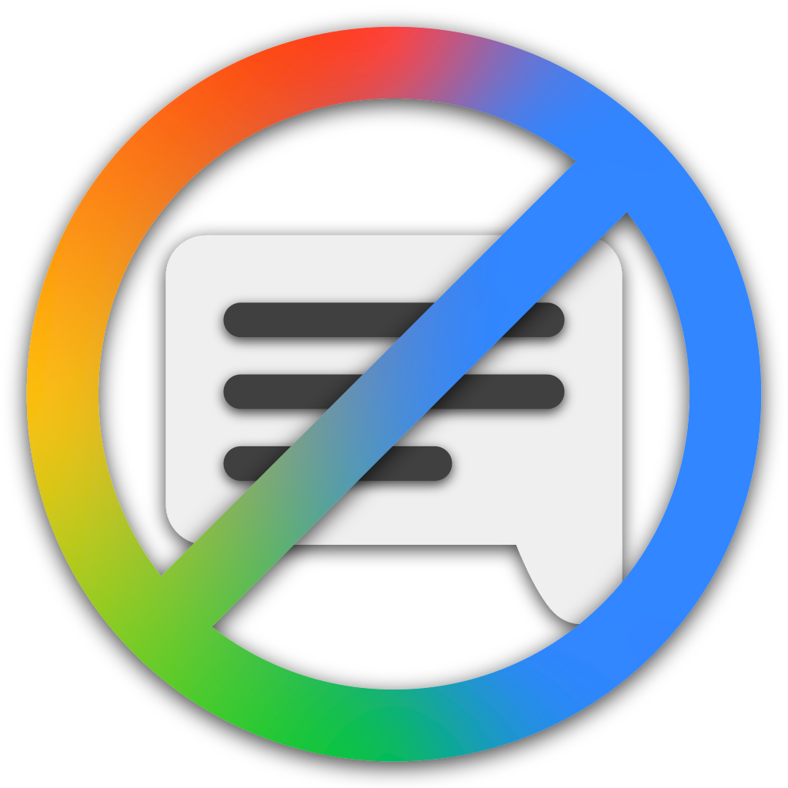
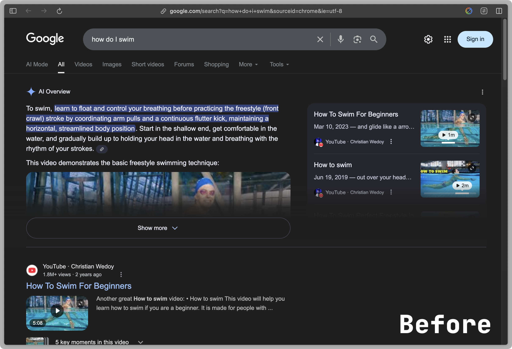
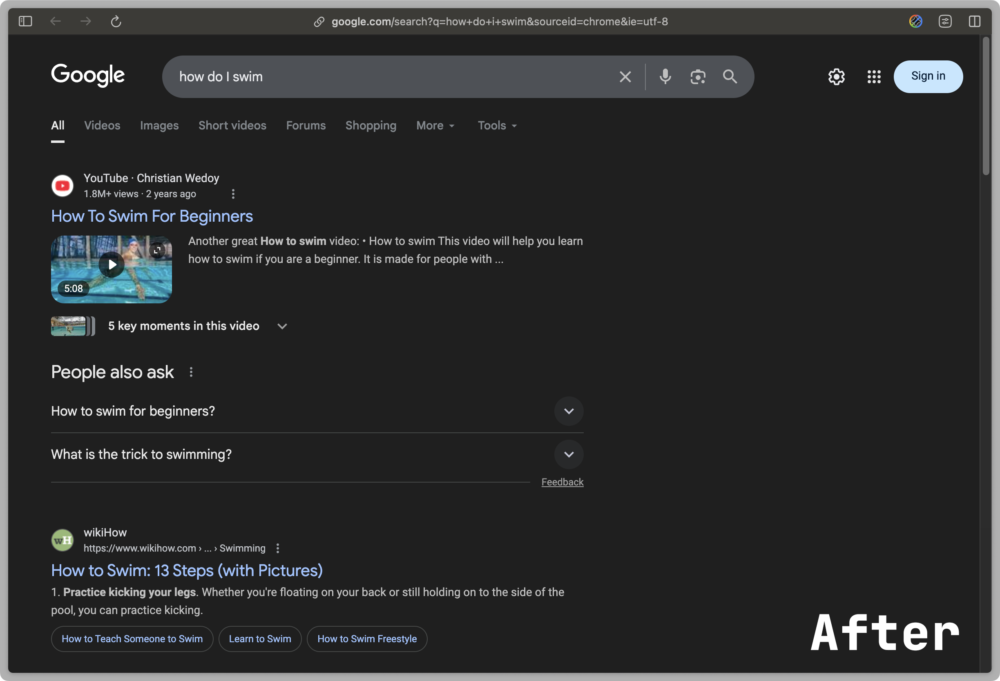
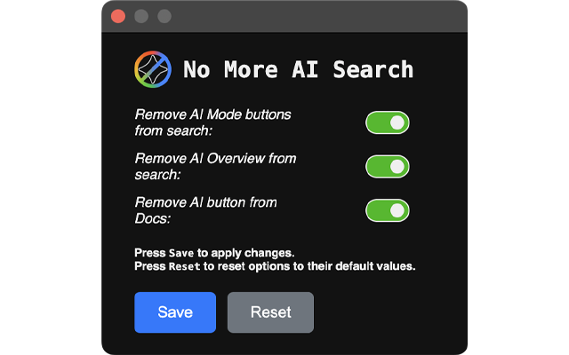

  
  
   
  
  <!--a href="https://addons.mozilla.org/en-US/firefox/addon/no-more-ai-search/"></a-->

 

  

<h3 align="center">
  <code>No More AI Search</code>
</h3>

<h6 align="center">
  forked by <a href="https://github.com/nickesc">nickesc</a> created by <a href="https://github.com/zbarnz">zbarnz</a>
</h6>

<!---

  
  

-->

## Overview

`No More AI Search` is a simple browser extension that attempts to remove AI results from Google Search results and Google Docs™. Compatible with Chromium™ and Firefox based web browsers.

This extension is based on [zbarnz's](https://github.com/zbarnz) [Google AI Overview Blocker](https://github.com/zbarnz/Google_AI_Overviews_Blocker) extension. This version also blocks the AI Mode button in the Google Search toolbar, the AI button in Google Docs™, and allows you to enable or disable features with custom settings.

| Without `No More AI Search`                 | With `No More AI Search`                          |
| ------------------------------------------- | ------------------------------------------------- |
|  |  |

## Install

Download `no-more-ai-search-<version>.zip` from the [latest release](https://github.com/nickesc/no-more-ai-search/releases/latest) and extract it.

### Chrome

1. Open `chrome://extensions`.
2. Turn on **Developer mode**.
3. Click **Load unpacked**.
4. Select the extracted folder.

### Firefox (temporary)

Requires Firefox 140 or later on desktop, or Firefox 142 or later on Android.

1. Open `about:debugging` and select **This Firefox**.
2. Click **Load Temporary Add-on**.
3. Select `manifest.json` in the extracted folder.
4. Refresh any open Google Search or Google Docs tabs to apply the extension.

Firefox removes temporary extensions when it restarts, so you'll need to do this again when it restarts.

## Options

Extension options can be accessed with the extension's Toolbar Button or the extension's settings page in `chrome://extensions` or `about:addons` > `No More AI Search` > `Extension Options`/`Preferences`

By checking or unchecking each of the options, you can enable or disable the features you want to use:

- Remove AI Mode buttons from search
- Remove AI Overview from search
- Remove AI button from Docs

<!---
## Installation

### Chromium™

- Download and install the extension from the [Chrome Web Store](https://chromewebstore.google.com/detail/no-more-ai-search)

### Firefox

- Download and install the extension from [addons.mozilla.org](https://addons.mozilla.org/en-US/firefox/addon/no-more-ai-search/)

### Manual

- Download and install the latest version of the extension for your browser from the [Releases](https://github.com/nickesc/no-more-ai-search/releases) page (`.crx` for Chromium™, `.xpi` for Firefox).
-->

## Privacy

`No More AI Search` checks page content in your browser to hide AI features. It sends no page content to the developer. See the [privacy policy](PRIVACY.md) for more details.

## Attribution

- [zbarnz](https://github.com/zbarnz) is the creator of the original [Google AI Overview Blocker](https://github.com/zbarnz/Google_AI_Overviews_Blocker) extension.
- Chrome, Chromium, and Google Docs are trademarks of Google LLC. Use of these trademarks is subject to Google Permissions. `No More AI Search` is not affiliated with, endorsed by, or sponsored by Google.
- Firefox is a trademark of the Mozilla Foundation in the U.S. and other countries.

## License

`No More AI Search` is licensed under the `MIT License`. For more information, view the repository's [`LICENSE`](LICENSE) file.
